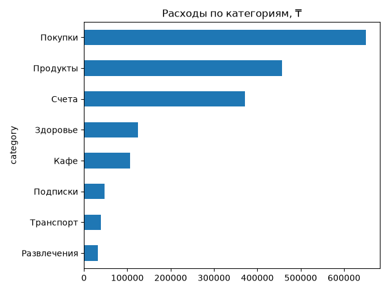
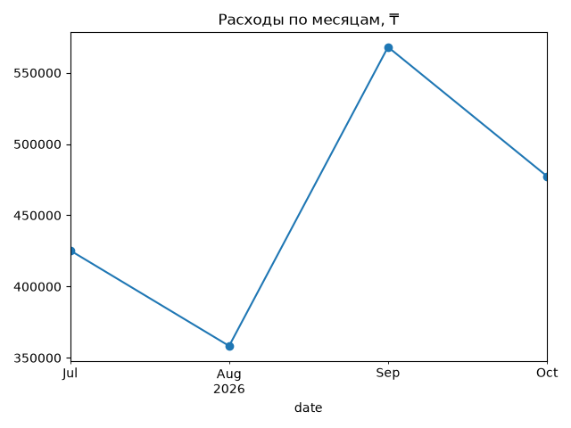

# Expense Analyzer

Анализ личных расходов на Python: автокатегоризация, поиск по датам, выявление аномальных трат и визуализация.

## Запуск
    python -m venv venv
    pip install -r requirements.txt
    python generate_data.py
    python main.py

## Алгоритмы
- **Сортировка слиянием** (O(n log n)): сортировка трат по дате.
- **Бинарный поиск** (O(log n)): выбор трат за период.
- **Поиск аномалий** (O(n)): траты больше среднее + 2σ.
- **Категоризация** по ключевым словам через словарь.

## Результаты

## Что дальше
Загрузка реальной выписки из банка, ML-категоризация.
